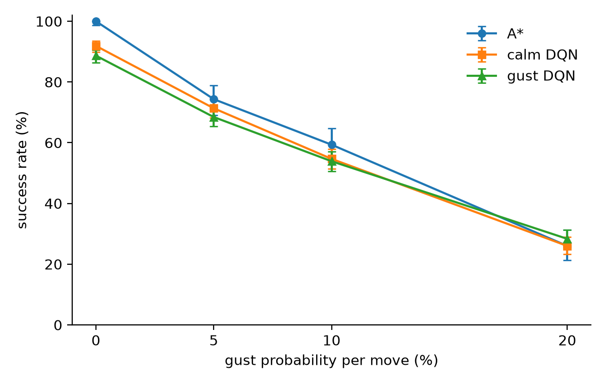
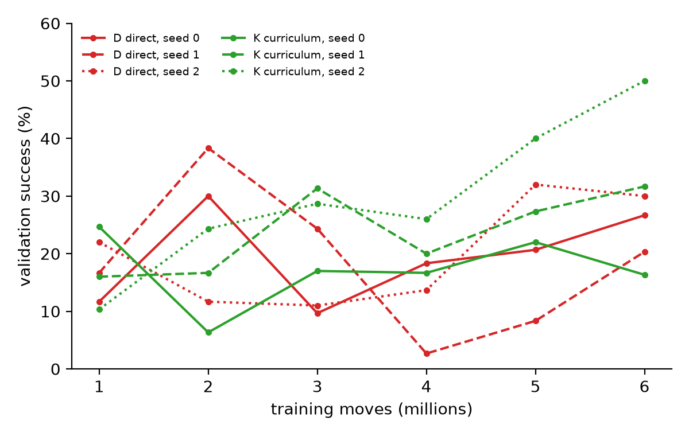
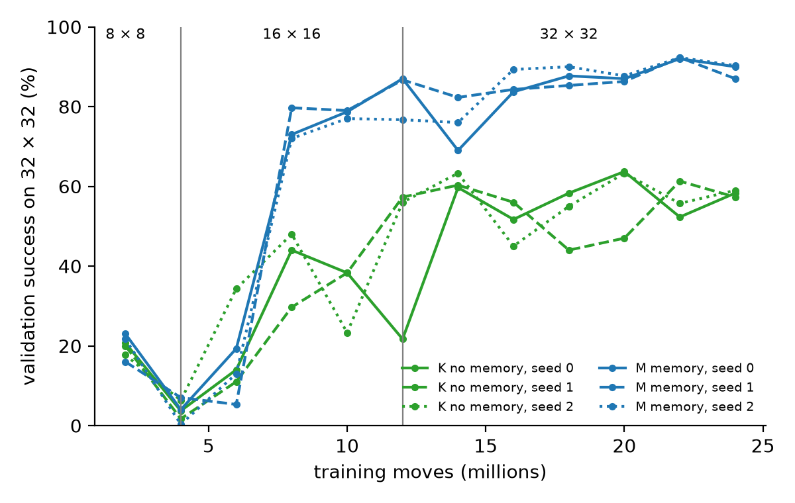

# AeroNav

A simulated drone with limited vision travels through a map with walls. The project compares a DQN model to A\* to see how close can the DQN get to 100% accuracy. 

Assisted by AI.

## Results

On 300 new 8 × 8 maps in calm air, the DQN reached the goal on 91.9% of flights (95% CI 89.9–93.5%, n = 900). Training in gusts did not make the DQN better in gusts: 28.3% vs 26.0% at 20% gusts.

On 16 × 16 maps the DQN initially scored 0%. Every flight crashed on the first move, because a crash cost −30 while
flying until the 400-move limit cost about −400. The reward was changed so a crash costs more than any timeout and
each move gives +10 for getting closer to the goal and −10 for getting farther away. After that the DQN reached
67.0% with 4-square vision and 84.8% with 12-square vision, with no crashes.

The start and goal were always opposite corners, so the drone might only have learned "go to the bottom-right".
With a random start and goal (shortest route at least 70% of corner to corner), the corner-trained DQN reached
15.9%, and a DQN trained with random start and goal and the reward fix reached 50.8%.

On 32 × 32 maps with random start and goal, a DQN trained on 32 × 32 from the start reached 22.2%, and one trained
on 8 × 8, then 16 × 16, then 32 × 32 (a curriculum) reached 33.4%, with the same number of training moves. The
curriculum won on more maps, but the three training runs varied too much (14–28% and 18–51%) to call it clear.

With 4 times more training (24,000,000 moves), keeping the checkpoint that scored best on the validation maps,
direct training reached 55.4% and the curriculum 61.4% (not clear). Training the curriculum drones for 8,000,000
more moves with a lower learning rate (0.0001) gave 64.1%, against 61.3% before (not clear).

Almost every failure was a timeout where the drone flew in loops. In 42 of 103 failed validation flights, there was
a route that got closer to the goal on every move, and the drone still circled. The drone had no way to know whether
it had already been on a square. I added 12 inputs, one per visible square, each set to 1 if the drone had visited
that square earlier in the flight. With this memory the drones reached 88.9% (95% CI 86.7–90.8%), against 59.2%
without it on the same maps (p < 0.001, clear). There were no crashes. Successful routes were a little longer: on
average about 90% as efficient as the shortest route, compared with 95% without memory.



Main test, maps 30,000–30,299. Error bars are 95% Wilson intervals.

| Experiment | Test maps | Compared | Result |
|---|---|---|---|
| Main test, 8 × 8 | 30,000–30,299 | A\*, calm DQN, gust DQN | 100%, 91.9%, 88.7% in calm air |
| Known wind | 40,000–40,299 | DQN with and without wind inputs | 20.8% vs 20.8% at 30% wind (p = 0.97) |
| Wider vision | 50,000–50,299 | 4 vs 12 visible squares | 18.1% → 23.1% at 30% wind (p < 0.001) |
| 16 × 16, original reward | 60,000–60,299 | diamond DQN | 0.0%, all crashes |
| 16 × 16, reward fix | 62,000–62,299 | plus / diamond DQN | 67.0% / 84.8%, no crashes |
| Replay buffer size | 63,000–64,299 | 50k, 1.5M, 5M | no size clearly best |
| Random start and goal, 8 × 8 | 70,000–70,299 | corner-trained vs random-trained DQN | 15.9% vs 50.8% |
| 32 × 32, random start and goal | 80,000–80,299 | direct vs curriculum training | 22.2% vs 33.4% (not clear) |
| 32 × 32, 4× longer training | 82,000–82,299 | direct vs curriculum | 55.4% vs 61.4% (not clear) |
| 32 × 32, fine-tuning | 83,000–83,299 | fine-tuned vs curriculum | 64.1% vs 61.3% (not clear) |
| 32 × 32, visit memory | 84,000–84,299 | with vs without memory | 88.9% vs 59.2% (p < 0.001) |

Each test was run once, on fresh maps, after its protocol and predictions were saved. DQN results combine 3
training seeds (n = 900); A\* has n = 300. A difference counts as clear only if the exact McNemar test on the same
maps gives p < 0.05 and the three seed ranges do not overlap.



32 × 32 validation success every 1,000,000 training moves, 3 training seeds each.



32 × 32 validation success during the 24,000,000-move curriculum, with and without visit memory, 3 training seeds
each.

The full report is in [docs/report.md](docs/report.md).

## Setup

Python 3.13. From the `AeroNav` folder:

```bash
python -m venv .venv
source .venv/bin/activate
pip install -r requirements.txt
```

Tests (139):

```bash
python -m pytest
```

Dashboard, with replays of real test flights:

```bash
streamlit run dashboard/app.py --server.address localhost
```

## Reproducing

The test flights are saved in `results/<experiment>/*_flights.csv`, so figures can be remade without training:

```bash
python -m experiments.report_figures
python -m experiments.final_test_figure
python -m experiments.failure_study
```

The test scripts (`final_test`, `wind_test`, `vision_test`, `scale_test`, `reward_test`, `buffer_test`,
`middle_test`) only run once and stop if their results already exist.

Training:

```bash
python -m experiments.dqn_validation_curve last_move     # calm DQN, 8 x 8
python -m experiments.dqn_validation_curve gust          # gust DQN, 8 x 8
python -m experiments.wind_training <aware|blind|aware_diamond|blind_diamond> <seed>
python -m experiments.reward_training <plus|diamond> <seed>     # 16 x 16
```

The final calm DQN is `results/models/final/dqn_calm_last_move_500k.zip`. Its settings are in `model_card.json` in
the same folder.

## Setup details

- 8 × 8 grid, 15% walls, start (0, 0), goal (7, 7), 4 moves, 200-move limit (400 on 16 × 16).
- Reward: +100 goal, −30 crash, −1 per move.
- DQN (Stable-Baselines3): inputs are position, goal, wall flags and last move; network 12 → 64 → 64 → 4;
  learning rate 3e-4; buffer 50,000; 500,000 training moves; the last checkpoint is the final model.
- A gust replaces a move with one of the other three at random. Every drone gets the same gusts on the same map.
- Map seeds for training (≥ 1,000,000), validation and testing never overlap. See `scenarios/splits.json`.

## Folders

```text
src/           environment, maps, A*, Q-learning, DQN, statistics
experiments/   training, validation, test runs, figures
tests/         unit tests
scenarios/     map seed splits
results/       one folder per experiment (flights, summaries, learning curves), plus models/, figures/, logs/
dashboard/     Streamlit dashboard
docs/          report and paper
```

Result folders: `01_baselines` (A\*, Q-learning), `02_dqn_tuning`, `03_main_test` (8 × 8 gusts), `04_wind`,
`05_vision`, `06_scale16` (16 × 16, original reward), `07_reward16`, `08_buffer16`, `09_middle16`,
`10_startgoal` (random start/goal), `11_scale32`, `12_scale32_long`, `13_scale32_finetune`, `14_memory` (visit
memory).

## Limitations

The grid is 2D with four moves and no physics. The maps are small. A\* sees the whole map, so it is a reference,
not an equal competitor. Each DQN has only 3 training seeds. The 16 × 16 reward fix changed two things at once.
Without memory, learning was unstable on 16 × 16, on random trips and on 32 × 32: success often rose and fell
between checkpoints. A bigger replay buffer, longer training and a lower learning rate did not fix it, but visit
memory made 32 × 32 learning much steadier. Memory was only tested on 32 × 32. From the long run on, the final model
was the best of 12 checkpoints on the validation maps, so those validation scores are optimistic. The test maps were
fresh, so the test scores are not.

## License

Public domain (the Unlicense). Anyone can use it for anything. See [LICENSE](LICENSE).
