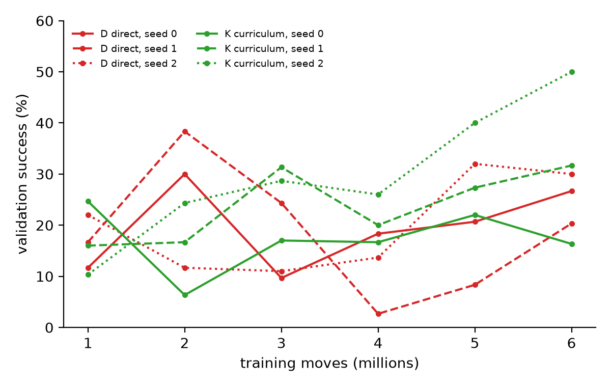
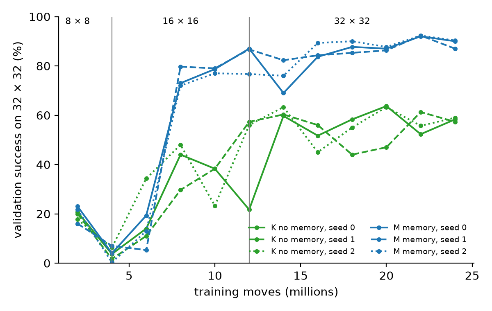

# AeroNav: Learned versus Planned Navigation for a Simulated Drone on Unseen Maps

## Abstract

I compared two ways of steering a simulated drone through grid maps with walls: A\*, a search algorithm that
sees the whole map, and a deep Q-network (DQN) that only senses the squares next to it. On 300 maps the DQN had
never seen, it reached the goal in 91.9% of flights (95% CI 89.9–93.5%, n = 900 over 3 training seeds), against
100% for A\*. All of its calm-air failures were loops, mostly near dead ends it could not sense. Training the DQN in
random gusts did not make it more successful in gusts. In follow-up experiments, telling the drone the wind
direction did not help, widening its view from 4 to 12 squares did, and on larger 16 × 16 maps the DQN failed
completely (0%) until I changed the reward, after which it reached 84.8%. With a random start and goal the
corner-trained DQN fell to 15.9%, while one trained on random trips reached 50.8%; on 32 × 32 maps a curriculum
(8 × 8, then 16 × 16, then 32 × 32) reached 33.4% against 22.2% without it, a difference within training-run variation.
Adding a memory of which nearby squares the drone had already visited raised 32 × 32 success from 59.2% to 88.9%.

## 1. Introduction

Autonomous drones often have to fly with limited information: their sensors cover a small area around them, and
the map may be new. Planning algorithms such as A\* find the shortest route but need a full map. Reinforcement
learning (RL) can produce a controller that acts on local sensor readings only, but it has to learn from trial and
error and may not transfer to new environments.

**Research question.** How does a DQN drone that senses only its four neighbouring squares perform on new,
never-seen maps, compared with A\*, which sees the whole map?

**Second question ("training in the storm").** Does training the DQN with random gusts make it better in gusts,
and does that cost anything in calm air?

**Hypotheses** (written before the final test):

- H1: the DQN succeeds on most unseen maps but below A\*, failing mainly by loops.
- H2a: the gust-trained DQN succeeds more often than the calm-trained DQN in gusts.
- H2b: in calm air, the gust-trained DQN succeeds slightly less often and takes longer routes.

This is a 2D grid simulation, not a flight controller. The aim is to compare the two approaches under controlled
conditions.

## 2. Methods

### 2.1 Environment

The world is an 8 × 8 grid with 15% of squares as walls, the start at (0, 0) and the goal at (7, 7). Each map is
generated from a seed and checked with breadth-first search so that a route always exists. The drone has four
actions (north, east, south, west). Reaching the goal gives +100, a crash into a wall or the edge gives −30 and
ends the flight, and every other move gives −1. A flight that reaches 200 moves is stopped (timeout). The
environment follows the Gymnasium interface and has 139 automated tests.

### 2.2 Drones

- **A\*** plans the shortest route with the Manhattan-distance heuristic and replans after every move. It sees the
  whole map, so it is a reference for the best possible route rather than an equal competitor.
- **Tabular Q-learning** (early baseline) learns a table of values for one fixed map. Trained on one map it found
  the 14-move shortest route, but on 300 new maps it succeeded on only 36 (12%), which is why a network was needed.
- **DQN** (Stable-Baselines3). Inputs: its position, the goal position, 4 wall flags (1 if the neighbouring square
  is a wall or off the map) and its last move, 12 numbers in all. Network 12 → 64 → 64 → 4. Learning rate 0.0003,
  discount 0.99, batch 64, replay buffer 50,000 moves, exploration falling from 1.0 to 0.05 over the first 30% of
  training, 500,000 training moves on random maps. The final model is always the last checkpoint.
- **Gust DQN**: identical, but trained with 10% gusts.

### 2.3 Gusts

On each move, with probability *p* a gust replaces the requested move with one of the other three, chosen at random.
The gusts are paired: the random numbers depend only on the map and *p*, so every drone meets exactly the same gust
at the same step on the same map.

### 2.4 Evaluation

Map seeds were split into training (≥ 1,000,000), validation (20,000–20,299) and test (30,000–30,299) sets that
never overlap. The test protocol was written and locked before the test, and my predictions were saved before I saw
any result. Each drone flew all 300 test maps once at *p* = 0, 5, 10 and 20%. Each DQN was trained with 3 seeds, so
DQN results have n = 900 flights per condition; A\* has n = 300.

Measures: success rate, crash rate, timeout rate, and on successful flights only, moves and route efficiency
(shortest route ÷ moves flown).

### 2.5 Statistics

- **95% confidence interval** for each success rate (Wilson score interval).
- **Same-map comparison** (exact McNemar test): only maps where exactly one of two drones succeeded are counted; if
  the drones were equally good, each such map would be a coin flip.
- **Seed spread**: the success rate of each of the 3 training seeds.

A difference is called clear only if p < 0.05 **and** the 3-seed ranges do not overlap. The McNemar test covers
luck in the choice of maps; the seed ranges cover luck in training.

## 3. Results

### 3.1 Main test

| Gusts | A\* (n = 300) | Calm DQN (n = 900) | Gust DQN (n = 900) |
|---|---|---|---|
| 0% | 100.0% | 91.9% (89.9–93.5) | 88.7% (86.4–90.6) |
| 5% | 74.3% | 71.3% (68.3–74.2) | 68.4% (65.3–71.4) |
| 10% | 59.3% | 54.7% (51.4–57.9) | 53.9% (50.6–57.1) |
| 20% | 26.0% | 26.0% (23.2–29.0) | 28.3% (25.5–31.4) |

*Success rate with 95% confidence interval. Test maps 30,000–30,299.*

**H1 (supported).** In calm air the DQN succeeded on 91.9% of unseen maps and A\* on 100%. On the same maps, A\*
succeeded where the DQN failed 73 times, and never the other way round (p ≈ 2 × 10⁻²²). The seed ranges (91.0–92.7%
vs 100%) do not overlap. Successful DQN routes averaged 14.99 moves against A\*'s 14.03 (efficiency 0.946). Every
calm-air DQN failure was a timeout. Replaying the 24 failures of the seed-0 drone showed that all were loops, 12 of
them entering a dead end the drone could not see with its four wall flags.

**H2a (not supported).** The gust-trained DQN was not clearly better in gusts at any level. At 20% gusts it scored
28.3% against 26.0% (p = 0.19, seed ranges 27.7–28.7% and 24.0–28.7% overlap).

**H2b (same direction, not clear).** In calm air the gust DQN scored 88.7% against 91.9%. On these maps the
difference was unlikely to be luck (p = 0.015), but the seed ranges overlap (85.3–92.3% vs 91.0–92.7%), so it
could come from training luck. Its successful routes were not longer (14.60 vs 14.99 moves).

**Gusts hurt every drone, A\* included.** At 20% gusts A\* also fell to 26.0%. Under gusts almost all failures were
crashes. Replaying all 378 crashes at 10% gusts (A\* and the seed-0 DQNs) showed that every one was caused by a
gust changing the move, not by the drone's own choice. A drone that cannot predict a random push has little to learn from it.

### 3.2 Follow-up experiments

Each follow-up had its own locked protocol, new test maps and predictions saved first.

**Known wind.** Instead of random gusts, a steady wind with a direction and strength (0–30%) that the drone could
sense through 5 extra inputs. At 30% wind the wind-aware DQN scored 20.8%, the same as the wind-blind DQN (20.8%,
p = 0.97). The wind-aware drone did not avoid squares with a wall directly downwind (24.4% of its moves vs 24.3%).
My explanation was that it can only see walls one square away, while avoiding a downwind wall requires knowing the
walls next to the square it is about to enter.

**Diamond vision.** I widened the sensor from 4 squares to all 12 squares within two steps. At 30% wind this
raised success from 18.1% to 23.1% for wind-aware drones and from 18.7% to 22.0% for wind-blind drones (both
p < 0.001, seed ranges do not overlap for the wind-aware pair). In calm air, timeouts fell from 11.8% to 7.7%.
With wider vision the wind inputs still gave no clear gain (23.1% vs 22.0%, p = 0.11).

**16 × 16 maps.** To test scale, I trained DQNs on 16 × 16 maps (15% walls, 400-move limit, 5,000,000 training
moves).

| 16 × 16 drone | Success | Crashes | n |
|---|---|---|---|
| Original reward (diamond vision) | 0.0% (0.0–0.4) | 100% | 900 |
| Reward fix, plus vision | 67.0% (63.9–70.0) | 0% | 900 |
| Reward fix, diamond vision | 84.8% (82.3–87.0) | 0% | 900 |
| A\* | 100% | 0% | 300 |

With the original reward every flight crashed on the first move. Random exploration on 16 × 16 never reached the
goal (0 of 1,000 random flights, against 2 of 1,000 on 8 × 8), so the drone never saw the +100. A crash costs −30,
while flying until the 400-move limit costs about −400, so crashing at once was the best choice it knew. I changed
two things: a crash now costs −(move limit + 1), more than any timeout, and each move earns +10 if it ends closer to
the goal and −10 if it ends farther away, on top of the usual −1. My first version gave a reward for moving closer
only, which a drone could exploit by stepping back and forth (+8 per pair). The symmetric version is
potential-based reward shaping (Ng, Harada & Russell, 1999), which does not change which route is best. After the
fix, the drones reached 67.0% and 84.8% with no crashes. The probe-2 drones scored similarly on two further sets
of new maps (65.7%/82.8% and 69.9%/83.2%).

**Learning stability.** Validation success on 16 × 16 swung between about 0% and 90% from one checkpoint to the
next. I tested whether a larger replay buffer would steady it, using 1,500,000 and 5,000,000 moves. Neither was
clearly better than 50,000 (diamond: 83.2%, 79.3% and 72.9% on the same maps; seed ranges overlap), and the curves
were not steadier.

**Random start and goal.** In every test so far the drone started at (0, 0) and the goal was the far corner, so the
goal inputs never changed. I picked start and goal at random from open squares, with the shortest route at least
70% of the corner-to-corner distance (10 moves on 8 × 8). A DQN trained this way with the original reward reached
7–31% on validation and then, by 400,000 moves, learned to crash within three moves on every flight, the same
crash-before-timeout problem as on 16 × 16. With the reward fix it never crashed, but its validation success fell
from 80–85% at 200,000–250,000 moves to 25%, 58% and 77% at 500,000. On 300 new maps (70,000–70,299) the
corner-trained DQN reached 15.9% (13.6–18.4) and the random-trained DQN 50.8% (47.5–54.0); A\* reached 100%. The
random-trained DQN succeeded where the corner-trained one failed on 389 maps and the reverse on 75 (p ≈ 4 × 10⁻⁵²),
and the seed ranges do not overlap (14.7–17.0% vs 22.0–74.7%). On the original corner maps it reached only 43.3%,
against 91.9% for the corner-trained DQN.

**32 × 32 maps.** With random start and goal (route at least 43 moves), the reward fix and 12-square vision, I
trained one DQN on 32 × 32 maps for 6,000,000 moves (D) and another on 8 × 8, then 16 × 16, then 32 × 32 maps
(1, 2 and 3 million moves; a curriculum, K). Both explored for the same number of moves. On 300 new 32 × 32 maps
(80,000–80,299), D reached 22.2% (19.6–25.1) and K 33.4% (30.4–36.6); A\* reached 100%, and no DQN crashed. K
succeeded where D failed on 210 maps and the reverse on 109 (p ≈ 2 × 10⁻⁸), but the seed ranges overlap (14.0–28.3%
vs 18.3–50.7%), so the difference is not clear. Validation success rose and fell between checkpoints for five of the
six drones.

**Longer training and fine-tuning.** I repeated the 32 × 32 comparison with 4 times more training (24,000,000
moves; K: 4, 8 and 12 million on 8 × 8, 16 × 16 and 32 × 32), keeping the checkpoint with the best validation score.
On 300 new maps (82,000–82,299), D reached 55.4% (52.2–58.7) and K 61.4% (58.2–64.6); p = 0.002, but the seed ranges
overlap (50.0–63.3% vs 57.0–64.3%), so it is not clear. Training the K drones for 8,000,000 more moves with a lower
learning rate (0.0001) gave 64.1% (60.9–67.2) against 61.3% (58.1–64.5) before, on maps 83,000–83,299 (p = 0.13, not
clear).

**Visit memory.** Almost all failures were timeouts. In 42 of 103 failed validation flights there was a route that
got closer to the goal on every move, yet the drone circled; it could not tell whether it had already been on a
square. I added 12 inputs, one per visible square, each set to 1 if the drone had visited that square earlier in the
flight, and retrained the long K curriculum with them (M). On maps 84,000–84,299, M reached 88.9% (86.7–90.8) against
59.2% (56.0–62.4) for K on the same maps; A\* reached 100%. M succeeded where K failed on 298 maps and the reverse on
31 (p ≈ 6 × 10⁻⁵⁶), and the seed ranges do not overlap (87.7–91.3% vs 56.7–62.0%), so the difference is clear. No
drone crashed. On successful flights, M's routes were about 90% as efficient as the shortest route, against 95% for
K. Validation success during the 32 × 32 stage stayed between 69% and 92% (Figure 6).

## 4. Discussion

The DQN learned a general strategy from local information: it reached the goal on over 90% of maps it had never
seen, with routes about 6% longer than the shortest. Its weakness is predictable from its inputs. With four wall
flags, 46.6% of situations look identical to a situation on some other map that needs a different move, so it
cannot tell a dead end from an open corridor until it is inside. The failures matched this: loops near dead ends.

The storm twist did not work as I expected. Random gusts are, by design, unpredictable, and the drone gets no
signal before one hits. Training in them gave no measurable benefit. A\* with a full map suffered just as much, which
suggests that under this gust model the limit is the disturbance, not the controller.

The follow-ups point the same way: what the drone can sense matters more than extra training conditions. Knowing
the wind did not help when the drone could not see far enough to use it, while seeing two squares away helped in
every condition. On 16 × 16, the main problem was the reward, not the network: a reward that made crashing the
cheapest option produced a drone that crashed, and fixing the incentive made the same setup work.

The corner-trained DQN had largely learned the corner: with random goals it fell from 91.9% to 15.9%. Training with
random goals fixed much of that, but learning became unstable, and on 32 × 32 neither longer
training nor a lower learning rate made it steady. The failures were loops, and a drone that cannot remember where
it has been cannot tell a loop from new ground. Visit memory fixed most of this. It supports the same lesson as the
earlier follow-ups: what the drone can sense or remember mattered more than how long it trained.

## 5. Limitations

- A 2D grid with four moves: no physics, altitude, speed, battery or sensor noise.
- Small maps (8 × 8 for the main study; 16 × 16 and 32 × 32 for exploratory follow-ups).
- A\* sees the whole map, so it is not an equal competitor.
- Gusts and wind are simple models.
- Three training seeds per DQN, enough to show that training luck matters but not to measure it precisely.
- Without memory, learning was unstable on 16 × 16, on random trips and on 32 × 32. Buffer size, longer training
  and a lower learning rate did not fix it; target-network updates were not tested.
- From the long run on, the final model was the best of 12 checkpoints on validation, so validation scores are
  optimistic. The test maps were fresh.
- Visit memory was only tested on 32 × 32.
- The random-trip drone differs from the corner-trained one in two ways (random trips and the reward fix).
- The 16 × 16 reward fix changed two things at once, so their separate effects are unknown.

## 6. Conclusion

A DQN that senses only its neighbouring squares reached the goal on 91.9% of unseen 8 × 8 maps, compared with
100% for A\*, and its failures came from dead ends it could not see. Training in random gusts did not help. Wider
sensing helped, and a reward that does not reward crashing was necessary for larger maps and for random goals. With
random start and goal the DQN reached 50.8% on 8 × 8. On 32 × 32 it reached 61–64% without memory and 88.9% with a
memory of visited squares. The next step is to test memory on 50 × 50 maps.

## References

1. Hart, P. E., Nilsson, N. J., & Raphael, B. (1968). A formal basis for the heuristic determination of minimum
   cost paths. *IEEE Transactions on Systems Science and Cybernetics*, 4(2), 100–107.
2. Mnih, V., et al. (2015). Human-level control through deep reinforcement learning. *Nature*, 518, 529–533.
3. Sutton, R. S., & Barto, A. G. (2018). *Reinforcement Learning: An Introduction* (2nd ed.). MIT Press.
4. Ng, A. Y., Harada, D., & Russell, S. (1999). Policy invariance under reward transformations: Theory and
   application to reward shaping. *Proceedings of ICML*, 278–287.
5. Raffin, A., et al. (2021). Stable-Baselines3: Reliable reinforcement learning implementations. *Journal of
   Machine Learning Research*, 22(268), 1–8.
6. Towers, M., et al. (2024). Gymnasium: A standard interface for reinforcement learning environments.
   arXiv:2407.17032.
7. Wilson, E. B. (1927). Probable inference, the law of succession, and statistical inference. *Journal of the
   American Statistical Association*, 22(158), 209–212.
8. McNemar, Q. (1947). Note on the sampling error of the difference between correlated proportions or percentages.
   *Psychometrika*, 12(2), 153–157.
